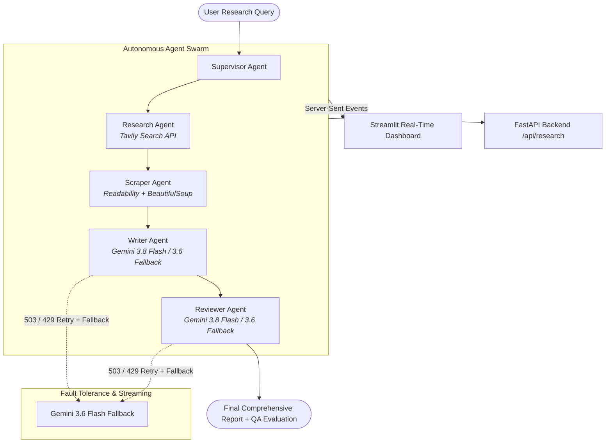

# CogniSynth: Autonomous Multi-Agent Research Intelligence Platform

**CogniSynth** is an enterprise-grade autonomous multi-agent research platform. It orchestrates a swarm of specialized AI agents to discover authoritative web sources, extract clean full-text article content, synthesize structured research reports, and perform rigorous quality assurance reviews in real time.

---

## Architecture Overview



---

## Agent Roles & Workflow

| Agent | Technology | Function |
| :--- | :--- | :--- |
| **Supervisor Agent** | Task Graph Controller | Orchestrates workflow execution, coordinates agent state transitions (`Active`, `Running`, `Idle`), and manages pipeline telemetry. |
| **Research Agent** | Tavily Search API | Formulates optimal search queries, discovers authoritative URLs, and fetches relevant snippets. |
| **Scraper Agent** | `readability-lxml`, `bs4` | Downloads server-rendered HTML, strips ads/scripts/trackers, and extracts clean, readable article content up to 5,000 chars per source. |
| **Writer Agent** | Google Gemini (`gemini-3.8-flash`) | Analyzes up to 30,000 characters of combined evidence, deduplicates facts, and drafts an executive-ready research report with deep technical insights. |
| **Reviewer Agent** | Google Gemini (`gemini-3.8-flash`) | Evaluates the report across 7 QA criteria (Accuracy, Completeness, Structure, Clarity, Depth, Objectivity, Source Utilization) and scores it 1–10. |

---

## Current Technology Stack

### Core AI & Language Models
- **Primary LLM**: Google Gemini **`gemini-3.8-flash`** (High speed, 1M context window, 4,000 max output tokens).
- **Fallback LLM**: Google Gemini **`gemini-3.6-flash`** (High availability backup to handle transient capacity spikes).
- **Framework**: `LangChain Core`, `LangGraph`.

### Web Discovery & Data Ingestion
- **Tavily AI**: Targeted web search API returning clean search metadata and snippets.
- **Readability & BeautifulSoup**: Removes DOM clutter (scripts, styles, navigation, ads) and extracts core readable paragraphs.

### Delivery & User Interface
- **FastAPI**: Asynchronous web framework exposing an SSE (Server-Sent Events) streaming endpoint at `/api/research`.
- **Streamlit**: Modern dark-mode dashboard with real-time agent status cards, telemetry logs, metric counters, and report rendering.

---

## Fault Tolerance & Resilience Engineering

1. **Automatic Exponential Backoff with Jitter**:
   - Detects HTTP `503` (High Demand / Spikes), `429` (Rate limits), and connection errors.
   - Automatically retries up to 3 times with progressive delays (`~2s`, `~4s`, `~8s`).
2. **Seamless Model Fallback**:
   - If `gemini-3.8-flash` experiences temporary upstream capacity overload, the pipeline automatically redirects the request to `gemini-3.6-flash`.
3. **Context Optimization**:
   - Bounded context window (`MAX_RESEARCH_CONTEXT_CHARS=30000`) prevents context clipping while ensuring rich research material reaches the writer agent.
4. **Resilient Exception Handling**:
   - Stream generators yield structured error events without terminating or crashing background runners.

---

## Configuration & Environment Variables

Key parameters in `.env`:

```env
# Google Gemini LLM Configuration
GEMINI_API_KEY=your_gemini_api_key
LLM_PROVIDER=gemini
LLM_MODEL=gemini-3.8-flash
LLM_FALLBACK_MODEL=gemini-3.6-flash
LLM_TEMPERATURE=0.2
LLM_MAX_TOKENS=4000

# Research & Scraper Bounds
MAX_SCRAPED_CHARS=5000
MAX_RESEARCH_CONTEXT_CHARS=30000
TAVILY_MAX_RESULTS=4

# Search Provider
TAVILY_API_KEY=your_tavily_api_key
```

---

## Running the Project Locally

### 1. Activate Virtual Environment
```bash
.venv\Scripts\activate
```

### 2. Start FastAPI Backend (Optional / API Mode)
```bash
python api.py
```
- API Endpoint: `http://localhost:8000/api/research?topic=<topic>`
- Swagger Docs: `http://localhost:8000/docs`

### 3. Start Streamlit Dashboard
```bash
streamlit run app.py
```
- Dashboard UI: `http://localhost:8501`