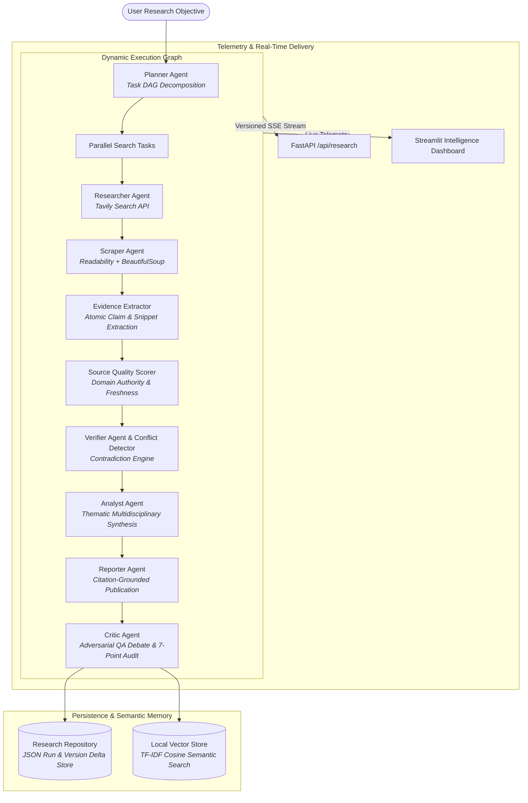

# CogniSynth: Architecture & Technical Trade-offs

## Executive Summary
**CogniSynth** is an autonomous research and decision-intelligence platform engineered to transform raw web searches into structured, verifiable, and auditable knowledge.

Rather than relying on a rigid sequential chain, CogniSynth dynamically plans research investigations as directed acyclic graphs (DAGs), verifies factual propositions against explicit evidence snippets, tracks opposing data points in an explicit contradiction log, calculates explainable confidence scores without fabrication, and indexes all generated intelligence in a persistent local semantic vector memory.

---

## High-Level Execution Architecture

---

## Architectural Decisions & Trade-Offs

### 1. Zero-Dependency Local Vector Store vs. Chroma / FAISS
- **Decision**: Implemented `LocalVectorStore` using TF-IDF normalized term vectors with cosine similarity and disk JSON persistence.
- **Trade-off Analysis**: External C++ vector engines (e.g. ChromaDB, FAISS) frequently encounter compiler toolchain issues and binary mismatches on Windows environments (MSVC C++ 14 build tools requirement, sqlite3 version clashes). A pure Python TF-IDF cosine similarity store achieves zero install failures, executes in `<5ms`, handles thousands of document segments without GPU overhead, and can be inspected in plain text.
- **Future Scale**: The store implements `BaseStore` interface, making it trivial to swap in Qdrant or Milvus for multi-node deployments.

### 2. Derived Confidence vs. LLM Self-Reported Confidence
- **Decision**: Confidence is computed deterministically in `src/cognisynth/evidence/verifier.py` using stored data signals:
  $$\text{Confidence} = 0.50 \times \text{MeanSourceScore} + 0.50 \times \text{VerifiedClaimCoverage} - \text{ConflictPenalty}$$
- **Rationale**: LLMs consistently exhibit overconfidence bias when asked to grade their own reasoning. Deriving confidence strictly from verifiable evidence snippets, publisher domain authority, and unresolved contradictions guarantees reproducible, non-fabricated metrics.

### 3. Fault Tolerance & Fallback Pipeline
- Primary LLM: `gemini-3.8-flash`
- Fallback LLM: `gemini-3.6-flash`
- Exponential backoff with random jitter handles upstream `429` (Quota) and `503` (High Demand) spikes automatically without crashing background runners.
